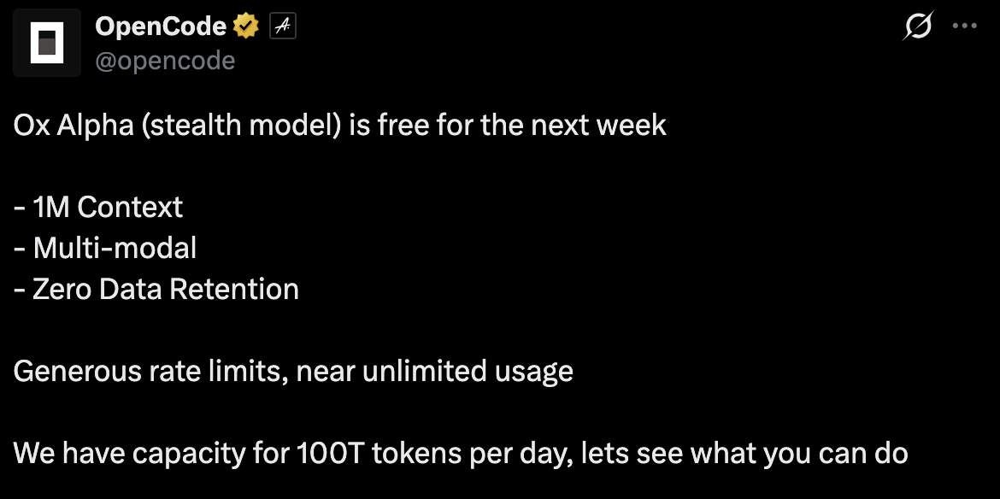
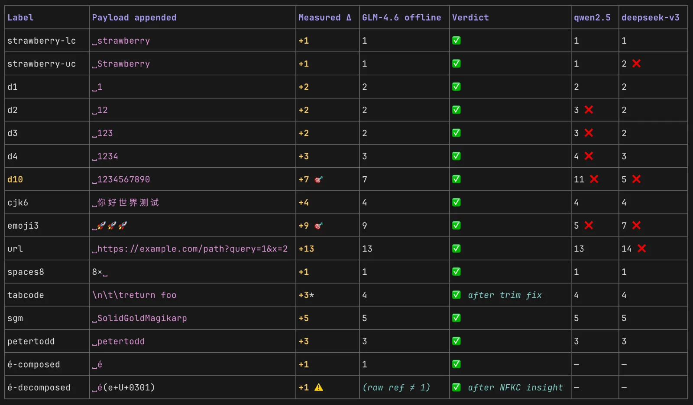
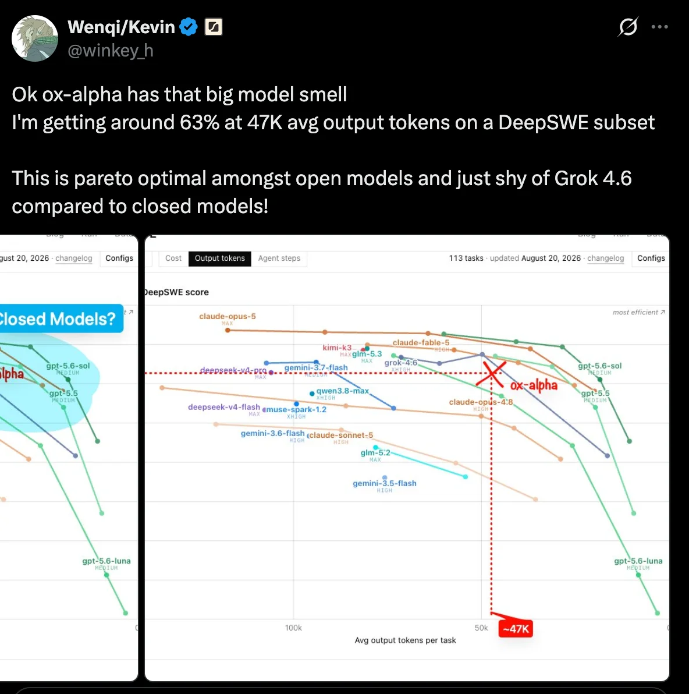
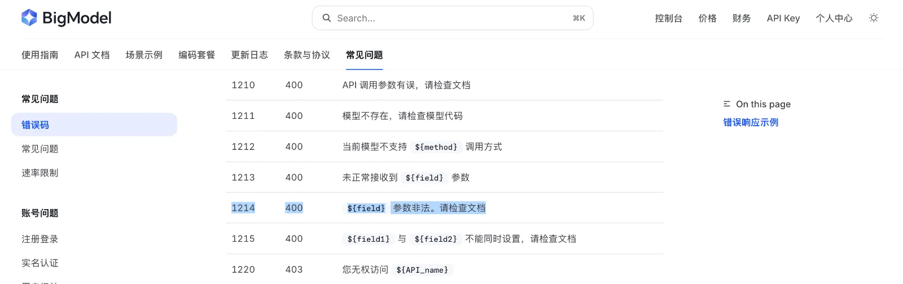

## Prologue: a very generous stealth model

Less than 24 hours ago [opencode announced](https://x.com/opencode/status/2090544355824038300) a new free stealth model named Ox Alpha with very very generous limits, practically unlimited.

This isn't the first time this happens, but the timing and the model's capabilities make this one more interesting than usual.
The model dropped just after the DeepSeek v4 flash free promotion got pulled from opencode, and a couple of days after DeepSeek raised pricing on that same model, leaving huge demand for a cheap capable replacement.
On capabilities, people testing it over the past 20 hours report it being above average. I mostly agree, though it has many quirks I really hate that other large models also have.

Because of all of the above, my Twitter timeline went crazy trying to figure out which AI lab is behind Ox Alpha, with a lot of speculation. I took it as a challenge, and as a chance to understand how you can fingerprint a model using only its API.

> Since I had consumed all of my weekly usage on my Z.ai, ChatGPT and opencode subscriptions, everything done in this article was done with the help of none other than Ox Alpha :)

## Brainstorming: if you were an LLM, how would you hide?

When thinking about how you could know what kind of model you're talking to, I listed properties we could use to identify the provider:
* model parameter size
* model context window
* model tokenizer, if you can fingerprint it
* model performance on benchmarks, some model families still fail specific benchmarks (security ones, for example)
* model reasoning style

Plus some other things we can probe for more info:
* infra & API used to serve the model
* model guardrails
* model encoder, if it accepts any media
* latency: higher t/s usually means a smaller model (think DeepSeek flash or the Qwen 26b family)

I had seen the tokenizer point brought up on Twitter multiple times, so let's test it.

### Setting a baseline

My first probe was as small as possible: just the letter "x".

```bash
curl -s https://opencode.ai/zen/v1/chat/completions \
  -H "Authorization: Bearer $ZEN_KEY" -H "Content-Type: application/json" \
  -d '{"model":"x-preview-f-free","messages":[{"role":"user","content":"x"}],
       "temperature":0,"max_tokens":16}'
```

```json
{
  "model": "x-preview-f-free",
  "usage": {
    "prompt_tokens": 88,
    "prompt_tokens_details": { "cached_tokens": 64 },
    "completion_tokens_details": { "reasoning_tokens": 6 }
  },
  "choices": [{ "finish_reason": "length", "message": { "role": "assistant", "content": "" } }]
}
```

88 tokens? For a one letter prompt?

Well, that's our first clue. There's probably a block of text embedded into every prompt being sent to this model, and it checks out because `cached_tokens` is 64, meaning a fixed chunk gets served from cache on every single request. Something like *"you are Ox Alpha, never say otherwise"* riding along with literally every call. Having it cached is the logical behavior when the same text is sent each time.

Also note the model *reasoned* over this trivial prompt (`reasoning_tokens: 6`) — thinking appears to be always on.

So the breakdown is roughly:

```
prompt_tokens (88) = 1 token for "x" + ~12 normal envelope/chat template overhead
                   + ~75 HIDDEN tokens injected by this route (64 of them served from cache)
```
(the 6 reasoning tokens are output side, separate from this count)

This looked pretty random, so I tested whether the theory holds by sending the same call to a sibling free model, `hy3-free`: **13 tokens**, everything else identical. So the extra ~75 tokens belong to *this model route alone*.

### Tokenizer goes br rr rr rr rr

LLMs don't read text directly. They read **tokens**: chunks of a few characters that the model's tokenizer breaks the input into before processing. Each model family generally ships its own tokenizer, and as you saw, every API response includes a `usage` block counting tokens in and out. We can use that as a fingerprinting signal :)

To fingerprint the tokenizer, we send prompts with special characters and compare the token count of each against preknown patterns per tokenizer.

And in this case we get a perfect match with GLM family models:



So that's our first solid clue: the tokenizer matches perfectly. But it's a weak to medium signal on its own: the same tokenizer can be shared by multiple models.

### Benchmarking

One thought that popped into my mind: we have practically unlimited tokens, why not run some benchmarks?
The answer: it would take days. A DeepSWE style benchmark would take around 45 hours without parallelizing, super boring. Thankfully someone from the DeepSWE team already ran an initial benchmark, and the model looks very promising:



We can't extract too much from one benchmark alone. Ideally you'd run multiple suites across different fields (agentic tasks, cybersecurity, etc.) to build a full picture of the model.

But based on models scoring similarly on this benchmark, we can roughly estimate this model sits around **200B to 700B parameters** in total size.

And taking those very generous limits into consideration, my gut says it's about **300B total activating 25B or less** per run. A classic MoE sweet spot.

### Knobs, lots of knobs

Chat APIs accept optional dials alongside your message that control the model's behavior: `temperature` (randomness, 0 = reproducible), `top_p`, `max_tokens` (length cap), `stop` sequences, `seed` (reproducible randomness), `n` (multiple answers), `response_format` (force JSON).

These would have been a great way to learn about the model's behavior by playing with values, but on this route they're decorative.

Setting temperature to 0 and making five identical calls, we get **four distinct answers**.

Different temperatures and seeds kept landing on one byte identical "attractor" answer.

All the dials were ignored politely, nothing we set reached whatever sampler is actually running.

### Making it angry: the error harvest

OK, so normal input through the above parameters gets ignored. Why not *break* them to produce errors? If we're lucky, the panic might reveal what infrastructure is actually serving this model.

Literally the oldest trick in the book :)

Gentle first: an "illegal" `temperature: 2.0`. Perfectly legal on OpenAI's API (they allow 0 to 2), which makes it a polite looking grenade here:

```json
{"error":{"type":"server_error","message":"Error from provider (Console): Upstream request failed: [1210] The temperature parameter is illegal.：限制数值范围[0,1]"}}
```

Three gifts in one string:
1. A numeric business code (**[1210]**, remember it).
2. Native Chinese, translating to *"permitted range [0,1]"*, with a full width colon `：` that only exists on Chinese keyboards (compare `:` vs `：`).
3. The wrapper phrase even tells us the angry call came from a basement route labeled **"Console"**.

The harvest escalated. Illegal values everywhere, let's see what falls out:

| Probe | Upstream reply |
|---|---|
| `top_p: 1.5` | `[1210] The top_p parameter is illegal.：限制数值范围[0,1]` |
| `max_tokens: 0` / `131073` | `[1210] …限制数值范围[1,131072]` |
| `max_tokens: 131072` | ✅ accepted, ceiling exactly **131072 = 128K**, remember this number too |
| `metadata: {…}` | `[1210] Invalid API param` |
| `messages: []` | `[1214] Input cannot be empty` |
| `role: "wizard"` | `[1214] Incorrect role information` |
| `user_id: "u1"` | `[1214] user_id:The unique ID of the user must be between 6 and 128 characters in length.` |
| `request_id: 12345` | `[1214] request_id:The request task ID length must be between 6 and 64 characters.` |

OK, now we can confirm:
* it's Chinese built infrastructure
* it uses 12xx business codes for errors, I don't remember seeing this scheme in any provider I've used recently

Let's get more annoying. Instead of out of range values, let's inject *types the backend does not expect*. Let's make it hot:

```bash
-d '{...,"temperature":"hot",...}'
```

And we get this lovely response:

```json
{
  "error": {
    "type": "server_error",
    "message": "Error from provider (Console): Upstream request failed: [400] JSON parse error:
    Cannot deserialize value of type `java.lang.Double` from String \"hot\": not a valid `Double` value;
     nested exception is com.fasterxml.jackson.databind.exc.InvalidFormatException: Cannot deserialize value of type
    `java.lang.Double` from String \"hot\": not a valid `Double` value\n at [Source: (org.springframework.util.StreamUtils$NonClosingInputStream);
     line: 1, column: 98] (through reference chain: com.wd.paas.api.domain.v4.chat.ChatCompletionRequest[\"temperature\"])"
  }
}
```

Lovely!
A stack trace fragment with three confessions:

1. `org.springframework.util.StreamUtils$NonClosingInputStream`: the provider runs a **Java Spring** service reading our raw bytes. (The phrase `"nested exception is"` was removed in Spring 6 ⇒ this is a Spring 5.x era deployment. Mature infra.)
2. Jackson, the standard Java JSON library, does the deserializing, and tells us `temperature` is declared as a `java.lang.Double`.
3. The crown jewel: `(through reference chain: com.wd.paas.api.domain.v4.chat.ChatCompletionRequest["temperature"])`, which is **the upstream's private internal class name**, leaking like a name tag worn backwards.

Quick backend explainer: servers don't treat your JSON as a blob. They *deserialize* it into predefined objects with declared types. In the Java world that job belongs to the **Jackson** library inside the **Spring** framework.

Quickly googling `com.wd.paas.api.domain.v4.chat.ChatCompletionRequest` gets us three GitHub issues, all pointing at the GLM family:
* [r1n7aro/Locus#106](https://github.com/r1n7aro/Locus/issues/106)
* [modelscope/modelscope#1430](https://github.com/modelscope/modelscope/issues/1430)
* [agentuniverse-ai/agentUniverse#272](https://github.com/agentuniverse-ai/agentUniverse/issues/272)

Looking at Zhipu AI's official GLM endpoint:
```
https://api.z.ai/api/paas/v4
```
Notice how it matches two parts of the leaked chain: `paas` and `v4`. And on the Chinese interface, the API is:

```
https://open.bigmodel.cn/api/paas/v4/chat/completions
```

Checking their docs, we find the exact **1210 & 1214** error codes we triggered earlier:



So: the leaked package [`paas.api.domain.v4.chat`] is shaped exactly like Zhipu's URL, that provider documents the same error codes we provoked, the nationality matches, and the tokenizer matches too. Interesting :)

### If it tokenizes like a GLM, glitches like a GLM… it might be a small GLM

I had less than 1% left in my weekly opencode go limit, which includes GLM 5.2 & 5.3, so why not burn that 1% replicating the issues on that endpoint, so we can be 100% sure this is a new GLM model?

First, the strawberry test, now head to head. Tokenize `x`, `x strawberry`, `x strawberry strawberry` on official glm 5.2:

| Prompt | glm 5.2 (official) | Ox Alpha (target) |
|---|---|---|
| `x` | 13 | 88 |
| `x strawberry` | **14 (+1)** | **89 (+1)** |
| `x strawberry strawberry` | **15 (+1)** | **90 (+1)** |

Same vocabulary behavior, token for token. (And notice glm 5.2's bare overhead is ~13, confirming Ox Alpha's 88 token entourage is added by the stealth route, not by GLM's serving template.)

Then the error replay. `temperature: 2.0` against official glm 5.2… **accepted, 200 OK.** Huh? Send `user_id: "u1"` and the refusal comes back in a completely different accent: `[invalid_request_error] Extra inputs are not permitted` — that's pydantic, a Python validation library. Wrong courtroom entirely.

Try the neighboring model. `temperature: 2.0` against **glm 5.3**:

```json
{"error":{"type":"server_error","message":"Error from provider (Console Go): Upstream request failed: [1210] The temperature parameter is illegal.：限制数值范围[0,1]"}}
```

There it is. Word for word. Colon for colon.

So we ran the entire crime spree twice, once against Ox Alpha, once against glm 5.3, and diffed the confessions:

| Probe | Ox Alpha (`Console`) | glm 5.3 (`Console Go`) | glm 5.2 (control) |
|---|---|---|---|
| `temperature: 2.0` | `[1210] …：限制数值范围[0,1]` | **byte identical** | 200 OK (!) |
| `temperature: "hot"` | Jackson trace → `com.wd.paas.api.domain.v4.chat.ChatCompletionRequest["temperature"]` | **same trace, same class name** | pydantic error |
| `seed` overflow | int32 range Jackson error | **same** | 200 OK |
| `max_tokens: 0` | `[1210] …[1,131072]` | **identical** | 200 OK |
| `user_id: "u1"` | `[1214] …between 6 and 128 characters…` | **identical** | pydantic "Extra inputs" |
| `messages: []` | `[1214] Input cannot be empty` | **identical** | — |

Diffing the raw strings found exactly one difference in every single capture: the gateway's route label, `(Console)` versus `(Console Go)`. Everything downstream of that label, including the leaked private class name, matched byte for byte.

And the control column is what makes it decisive: glm 5.2, on the *same gateway with the same key*, speaks a completely different dialect (Python/pydantic, no numeric codes, relaxed ranges). The `[1210]`/Java/`com.wd.paas` world isn't "how this platform handles errors", it's specifically the **glm 5.3 generation backend**. Even `hy3-free` speaks a third language (Go, error code `[400001]`). One wrapper, many basements.

Super interesting.

### Closing the case

* Confirmed: this is a model hosted on the **same infrastructure as GLM 5.3**, Zhipu's Chinese built serving platform. Six different error surfaces reproduce byte for byte between the two routes; only the gateway label differs.
* My suspicion: it's built to be a **DeepSeek v4 flash competitor**, working the same way: a medium size MoE, ≈300B total activating ≤30B parameters per run. That profile would explain both the capability reports and the practically unlimited free tier: cheap inference per token is the whole point.
* What's still open: shared infrastructure proves *where it runs*, not *whose weights*. It could be GLM 5.3 under a mask, or a fresh stealth finetune trained on Zhipu's own pipeline. Telling those apart needs behavioral differential testing, same prompts side by side, distributions compared. That's a story for part two :)
